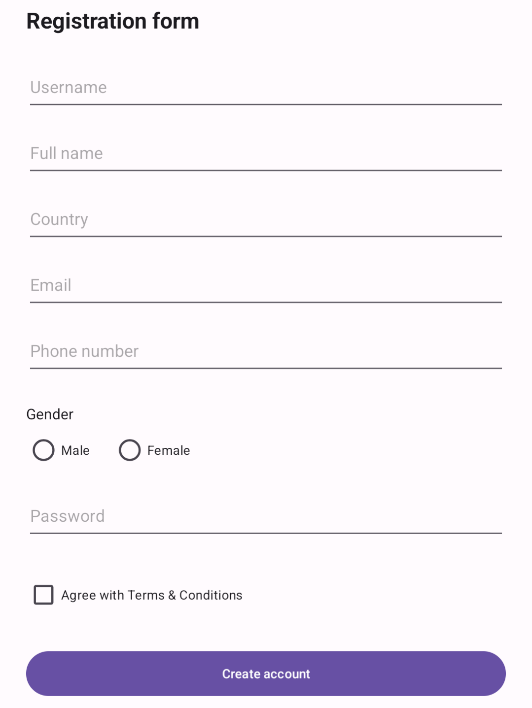

# RegistrationForm

Preprosta Android aplikacija za registracijo uporabnika, izdelana v programskem jeziku **Java** z uporabo **XML**.

Projekt je bil razvit v okolju Android Studio kot del šolske naloge pri predmetu Razvoj mobilnih aplikacij.

## Funkcionalnosti

- Vnos uporabniškega imena, imena in priimka, države, e-pošte, telefonske številke in gesla.
- Izbira spola z uporabo `RadioGroup` in `RadioButton`.
- Potrditev pogojev uporabe z `CheckBox`.
- Prikaz vnesenih podatkov v pogovornem oknu `AlertDialog`.
- Pomikanje po obrazcu z uporabo `ScrollView`.

## Posnetki zaslona

### Registracijski obrazec

## Uporabljene tehnologije

| Tehnologija | Namen |
|---|---|
| Java | Programska logika aplikacije |
| XML | Oblikovanje uporabniškega vmesnika |
| ScrollView | Pomikanje po obrazcu |
| Android Studio | Razvojno okolje |
| Gradle | Gradnja projekta |

## Delovanje aplikacije

Uporabnik vnese svoje podatke, izbere spol in po želji potrdi pogoje uporabe.

Ob pritisku na gumb **Create account** aplikacija prebere vnesene podatke in jih prikaže v pogovornem oknu **Registration Details**.

Aplikacija ne izvaja dejanske registracije in ne shranjuje uporabniških podatkov.

## Zagon projekta

1. Prenesite ali klonirajte repozitorij.
2. Odprite projekt v Android Studiu.
3. Počakajte na sinhronizacijo Gradle.
4. Izberite emulator ali Android napravo.
5. Zaženite aplikacijo z gumbom **Run**.

## Namen projekta

Cilj projekta je spoznati delo z vnosnimi polji, izbiro možnosti, potrditvenimi polji in prikazovanjem podatkov v pogovornem oknu.

Projekt je namenjen izobraževalnim namenom.
